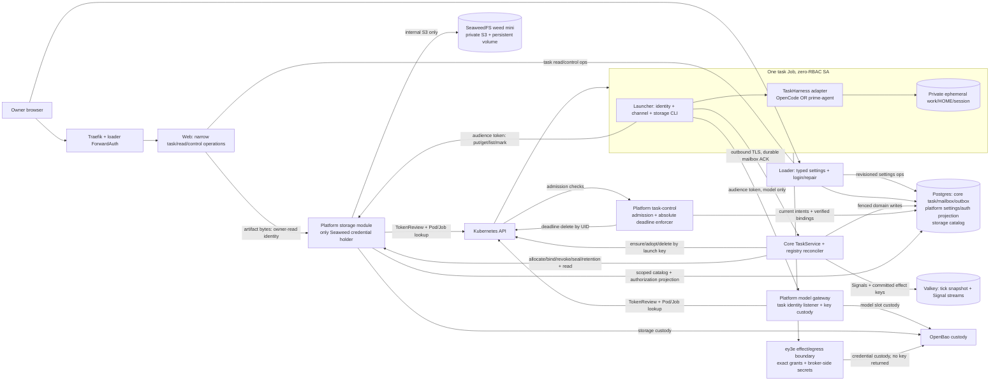
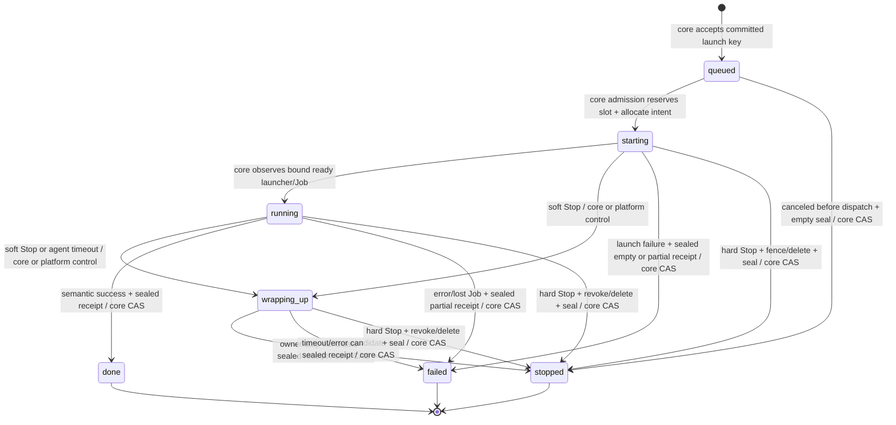

# Task runtime: the views behind ADR-014 and ADR-015

Date: 2026-10-20. Design for lifemodel-653.5, not built behaviour.
[ADR-014](../../adr/014-task-runtime.md) owns tasks;
[ADR-015](../../adr/015-storage-module.md) owns storage. The owner's confirmed
feature frame plus the four leaf-task answers are the authority. Step A is
[options history](tasks-options.md), with changed recommendations marked.

## Component view (C4 level 2, trust and state ownership)



Arrows are allowed logical operations, not broad network grants. The TLS task
listeners require the explicit audience tokens of ADR-014 D1; direct task→SQL,
Valkey/API/Bao/Seaweed/core-model-listener are denied. No task ingress exposes
harness RPC. DNS and the narrowly approved runtime routes are exceptions to
default deny, not permission for arbitrary cluster addresses. Only effect
boundary has approved tool destinations. Module credentials never cross back.
Web raw DB arrows above denote **implementation behind domain ports**, not pg
clients in handlers. Core schema task operations and storage/schema grants are
separate. No task script can query any schema or choose a bucket/prefix.

The admission/deadline component is platform task control, not a second launch
queue or executor service. Core initiates Jobs and owns task intent/outcome;
control validates admission and executes persisted stop deadlines while core
is down. It is the only non-core actor with narrowly scoped task cleanup
rights; it cannot submit new work. Storage enforces its own access revision,
not a task IAM policy or core HTTP round trip.

## Durable ownership and port contracts

| Owner | Durable facts | API/consumer |
| --- | --- | --- |
| Core (`core` schema) | Task/launch identity, briefing/profile/harness/image revision, accepted order/urgent, stop cause/deadlines, terminal candidate/outcome, mailbox ACK/cursors, outcome outbox, cleanup state | TaskService; cognition tools use port, web uses narrow task operations |
| Platform settings scope | Typed Motor declarations/values/revision and authority/apply timing | Loader generated UI; core reads effective snapshot, admission validates ceilings |
| Platform task-control scope | Read-only-to-consumers verified launch/Job/Pod binding and access mode/revision, deadline work receipts | Verifier/deadline component writes from committed intents + API; storage/model read narrow projection |
| Storage (`storage` schema) | Space binding/access revision, upload/reservation/mark ledger, immutable manifests, deletion plans/read leases/tombstones and receipts | Own API: task data, core control/read, web read, health separated |
| Seaweed PVC | Private immutable bytes, filer metadata, backend auth/config as required | Only storage S3 adapter; platform recovery backs up all required state |
| Valkey | Committed core snapshot/Signal streams, not artifact bytes or task authority | Existing core seams; no per-task Valkey passwords |
| Job ephemeral volume | Local work/HOME/harness session/command acceptance IDs only | Not a durable product store; core restart leaves it, Pod loss never promises replay |

`TaskExecutor.ensureStarted/observe/requestSoftStop/deleteNow` returns stable
external handles without leaking Kubernetes status to cognition. `TaskHarness`
normalizes start/steer/wrap/abort and step/question/artifact/terminal events.
Both real adapters pass the same contract; a fake executor proves a second
backend changes no caller. One workbench ships both pins/offline dependencies.

Task-service method names `stopAll` / `setUrgent` are dedicated fields/actions,
not attribute-prefix routing. Cross-core effects use committed idempotency keys;
storage control requests carry expected revision and effect key. Every wait/
network request has a bounded timeout; infrastructure failures retry keyed
operations, invalid profiles/tokens/names do not retry unchanged input.

## Task state machine



Persisted spelling is `wrapping-up`; diagram uses `wrapping_up` as an identifier.
No special `finalizing` public state: `finalizationPending`, terminal candidate,
seal receipt and cleanup fields annotate the current nonterminal state. Stop
is not terminal until a durable seal receipt can name retained partial output.
While storage is down, pending reason is visible even though compute is already
removed; this cannot keep a slot occupied after Pod termination is confirmed.

| Edge/operation | Actor and order | Race/restart rule |
| --- | --- | --- |
| accept→queued | Core after deciding-turn commit; persist immutable launch key and settings/profile snapshot | Replay returns same task; queue is not an in-memory Promise |
| queued→starting | Core locks admission row, checks cap/priority/profile, reserves, allocates storage | Allocation/Job create retries by key; no second launch ID on lost response |
| starting→running | Core observes verified Job UID + Pod UID + launcher handshake | Binding must exist before data/model access; deterministic name adopts delayed create |
| running/starting→wrapping-up | Persist owner Stop or due timeout, deny new effects, command harness wrap, set absolute hardStopAt | Repeat cannot extend deadline; platform deadline enforcer works while core down |
| nonterminal→terminal candidate | Core/reconciler persists semantic success/error or stop reason; remove compute as needed | Hard stop beats an uncommitted success candidate; terminal CAS never changes afterward |
| candidate→done/failed/stopped | Core freezes/revokes storage, ends compute, obtains seal receipt, CAS terminal + outcome outbox | One terminal key, duplicate result/Job watch/seal replies harmless; missing result never fake success |
| cleanup pending→complete | Core or platform cleanup reconciler confirms Pod/ephemeral PVC gone, module confirms unmarked bytes deleted | Independently replayable; no terminal task reopened, no slot released for unknown live compute |

Failure reasons distinguish model/tool/infra/timeout and preserve partial result
references. A stopped task can have useful result files but remains stopped.
Task deletion/Pod eviction never auto-runs the shell again. Queued/starting
soft Stop creates no computation solely to wrap; pending create is fenced.
A queued failure before allocation uses an idempotent empty sealed receipt so
outcome shape stays explicit. Terminal/outbox delivery is at-least-once with
idempotent consumer, not an exactly-once external action guarantee.

### Stops, clocks and queue order

```mermaid
sequenceDiagram
    participant Caller as Owner panel/chat or agent timeout
    participant Control as Task control intake
    participant DB as Postgres intent + access projection
    participant Task as Job launcher + harness
    participant Store as Storage module
    participant K as Kubernetes
    alt Soft Stop / timeout
        Caller->>Control: softStop(taskId, requestId)
        Control->>DB: record cause, wrapping, immutable hardStopAt
        Control->>DB: revoke new external-effect grants
        Control-->>Task: wrap: finish local step, save + mark + result
        Task->>Store: put and mark while wrapping
        Note over Control,K: hardStopAt = first Stop + snapshot grace; default 300 s
        Control->>K: delete at hardStopAt if still running
    else Hard stop now
        Caller->>Control: hardStop(taskId, requestId)
        Control->>DB: stop/revoke intent before side effects
        par No harness/upload wait
            Control->>Store: revoke current space revision
        and No seal wait
            Control->>K: DELETE Job by UID, zero requested grace
        end
    end
    Note over DB,K: timeout also has Job activeDeadlineSeconds = timeout + wrap grace
    Note over Store,K: module seal and terminal receipt may complete after compute deletion
```

Core handles normal task commands; direct owner Stop intake and platform
deadline enforcement do not require a cognition turn. Eventual delete latency
under API/node failure is reported unhealthy, not claimed instantaneous.
Five minutes is wrap time, not Kubernetes termination grace to leave runaway
compute alive after the hard deadline. Soft-stop `hardStopAt` survives core/
control restart and is never extended by another click or setting change.

Queue key `(urgent first, original accepted sequence, taskId)` is durable.
Owner or agent can change urgent while queued; new urgency does not create a
new task or preempt running work. Default cap 2 is an engineering default
subject to platform ceiling, not a measured machine limit. Starting/Pending/
running/wrapping compute consumes a reservation until termination is known.
After cap decreases, old tasks drain. 100-task fixture/cap=2/two dispatchers
checks aggregate admission; starvation under endless urgent work is explicit.
Stop-all snapshots all current nonterminal IDs into a durable batch and soft
stops each, including canceling queued entries; core/chat stays alive and new
acceptances are outside that batch.

## Launch → live channel → mark → end → seal → reply

```mermaid
sequenceDiagram
    actor O as Owner
    participant C as Core / TaskService
    participant P as Postgres task + mailbox/outbox
    participant S as Storage module
    participant K as Kubernetes + platform admission
    participant T as Job launcher / selected harness
    participant M as Model gateway
    participant W as Web
    O->>C: asks for long work
    C-->>O: ordinary reply now (no task chip)
    C->>P: committed turn key → queued task + briefing/profile/revisions
    C->>P: reserve urgent/FIFO slot; queued → starting
    C->>S: allocate(taskId, launchId, effectKey)
    S-->>C: stable space ID (not a secret)
    C->>K: ensure deterministic Job, image/profile/hard deadline
    K->>P: verify current epoch/reservation/template
    K-->>C: Job UID or unknown response → adopt by name
    C->>S: bind verified Job/Pod UIDs via platform authority
    T->>C: audience token; connect/resume mailbox
    C->>P: verify binding; persist running + cursors
    T->>M: model via task identity relay/header
    M-->>T: filtered completion; no key
    loop Live task work
        T->>C: step/finding/question with event ID
        C->>P: insert event before ACK; emit Signal
        C-->>T: ACK + steer command with command ID
        T-->>C: adapter accepts command, ACK once
        T->>S: direct put chunk/object (not through core)
        S-->>T: durable object receipt
        T->>S: markResult(objectId, log/result/artifact)
        S-->>T: durable mark receipt
    end
    T->>C: semantic terminal report + marked result references
    C->>P: terminal candidate; not done yet
    C->>K: confirm stopped / delete Job; no new effects
    C->>S: freeze/revoke + seal(taskId, effectKey)
    S->>S: fixed marks → hashed manifest; delete unmarked; receipt
    S-->>C: sealed manifest ID/hash + partial reason if any
    C->>P: CAS one terminal + unique outcome outbox
    C-->>O: ordinary summary + artifact-ID attachments
    O->>W: open authenticated attachment
    W->>S: narrow read operation using web identity
    S-->>W: bytes under read lease (no S3 URL/key)
    W-->>O: no-store attachment download
```

A successful Job alone is not a successful task. No task decides its final
published status or can bypass seal. Hard Stop may interrupt this sequence at
any point: storage keeps only pre-freeze stored marks; candidate/cleanup
reconciliation finishes without the removed Job. The core does not wait for
artifact bytes during a conversation turn. Allocation/seal are keyed async
infrastructure effects with explicit timeouts, not held cognition tool loops.

## Storage access and seal view

```mermaid
stateDiagram-v2
    [*] --> allocated: core allocate key
    allocated --> open: platform binds actual Job and Pod
    open --> wrapping: soft Stop mode
    open --> frozen: normal end / hard revoke / failed Job
    wrapping --> frozen: harness end or hard deadline
    frozen --> manifest_committed: storage hashes fixed marked objects
    manifest_committed --> sealed: unmarked/incomplete cleanup confirmed
    sealed --> delete_planned: age or quota / policy revision
    delete_planned --> sealed: pin/policy changed; cancel selection
    delete_planned --> deleting: batched notice receipt + lead elapsed + read check
    deleting --> deleted: confirm S3 deletes; ledger/tombstone
    deleted --> [*]
```



Runtime identity checks happen in storage module on every operation/bounded
chunk, including while core process is down. A revoke has a durable access
revision linearization point: no new chunk authorizes after ACK; previously
sent bytes cannot be recalled. Missing live API/binding/authority fails closed.
Only module holds Seaweed signing credentials, and only module speaks S3.
`sealed` is read-only, with private byte IDs/hashes, not task filesystem paths.
Owner/core read roles can read marked output; task loses rights at freeze.

Defaults: 90-day age, forever disables age, pin blocks automatic deletion;
20 GB decimal logical ceiling also charges reservations. Quota pressure may
propose unpinned forever output for warning-first reclamation, never a pin or
active space. Warning lead default 24 h; core emits one keyed batched ordinary
reply, module waits for persisted notice receipt plus lead time. No core/notice
means deletion waits, not a silent age eviction. These engineering policy
interpretations are explicit in ADR-015, not additional owner quotes.

## Acceptance trace and known evidence limits

ADR-014 T01–T12 and ADR-015 S01–S10 are the closed constraints. Walks use one
k3s node/two concurrent distinct-profile tasks; queue fixture is 100 at cap 2
with two contenders; pressure fixture is 20×4 MiB chunk streams; restore is
32×4 MiB objects plus two partials. These are concrete evidence sizes, not an
unsupported claim of arbitrary scale. Tests/walks are stage obligations; none
ran as a runtime probe during this documentation task.

Core restart, storage process restart and abrupt task loss are distinct checks.
Single node is not protection against disk loss; backup generation, objects,
filer/IAM/custody/catalog/tombstones must restore together. Full offline pins,
real gateway/live harness contract, token bound-UID support and API deadline
failure are first acceptance risks. Independent design review and stage
implementation evidence must remain separate from this intended model.
